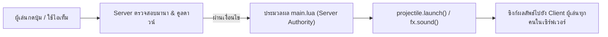

# ⚡ บทเรียนที่ 7: การสร้างพลังและสกิลต่อสู้ (Powers & Combat Skills)

ใน **Shyne Creator** นอกเหนือจากการตกแต่ง Avatar สวยงามแล้ว ตัวม็อดยังมีระบบ **Gameplay API** ที่ทรงพลัง ซึ่งอนุญาตให้ผู้สร้าง (Creators) สามารถสร้าง **สกิลต่อสู้ (Combat Skills), กระสุนเวทมนตร์ (Projectiles), บัฟป้องกันตัว (Wards), และอัลติเมต (Ultimates)** ได้อย่างเต็มรูปแบบ โดยระบบจะทำงานและคำนวณที่ Server Authority ทำให้ปลอดภัย ไม่สามารถโกงมานา และทุกคนในเซิร์ฟเวอร์จะเห็นเอฟเฟกต์เหมือนกันหมด

---

## 📌 สารบัญบทเรียน
1. [ภาพรวมของ Gameplay Pack](#1-ภาพรวมของ-gameplay-pack)
2. [โครงสร้างโฟลเดอร์ของแพ็กพลัง](#2-โครงสร้างโฟลเดอร์ของแพ็กพลัง)
3. [การสร้างไฟล์คอนฟิกแพ็ก (mod.json และ shyne-package.json)](#3-การสร้างไฟล์คอนฟิกแพ็ก)
4. [การสร้างสกิลแรก (Skill Definition JSON)](#4-การสร้างสกิลแรก-skill-definition-json)
5. [การเขียนสคริปต์ควบคุมการทำงานของพลัง (main.lua)](#5-การเขียนสคริปต์ควบคุมการทำงานของพลัง-mainlua)
6. [การสร้างสกิลประเภทต่างๆ (Projectile, Area Buff, Ultimate Combo)](#6-การสร้างสกิลประเภทต่างๆ)
7. [การผูกสกิลกับปุ่มลัดและวงล้อคำสั่ง (Action Wheel)](#7-การผูกสกิลกับปุ่มลัดและวงล้อคำสั่ง)
8. [การทดสอบสกิลในเกม](#8-การทดสอบสกิลในเกม)

---

## 1. ภาพรวมของ Gameplay Pack

ระบบพลังใน Shyne Creator ประกอบด้วย 2 ส่วนที่ทำงานร่วมกัน:
1. **Skill Definition (`skills/*.json`):** กำหนดสเปกของพลัง เช่น ชื่อ, ชนิดการร่าย (`cast_type`), ปริมาณมานาที่ใช้ (`mana_cost`), คูลดาวน์ (`cooldown_ticks`), และไอคอนแสดงผล
2. **Server-Side Lua Hook (`main.lua`):** รับคำสั่งเมื่อผู้เล่นร่ายสกิลสำเร็จ แล้วปล่อยลูกกระสุน (`projectile.launch`), เล่นเสียง (`fx.sound`), หรือสร้างอนุภาค (`fx.particle`)



---

## 2. โครงสร้างโฟลเดอร์ของแพ็กพลัง

สร้างโฟลเดอร์แพ็กพลังของคุณไว้ที่:
```text
.minecraft/shyne-mods/my_power_pack/
├── mod.json                (ข้อมูลแพ็กและ Entry point)
├── shyne-package.json      (ประกาศรายการไอคอน UI)
├── main.lua                (สคริปต์ปล่อยพลังและคำนวณความเสียหาย)
├── assets/
│   └── icons/
│       ├── arc_bolt.png    (ไอคอนสกิล 32x32 หรือ 64x64 PNG)
│       └── starfall.png
└── skills/
    ├── arc_bolt.json       (คำจำกัดความสกิลที่ 1)
    └── starfall.json       (คำจำกัดความสกิลที่ 2)
```

---

## 3. การสร้างไฟล์คอนฟิกแพ็ก

### `mod.json`
ไฟล์นี้ใช้บอกตัวเกมว่าแพ็กนี้คืออะไรและรันสคริปต์ที่ไหน:
```json
{
  "id": "my_power_pack",
  "name": "My Epic Powers",
  "version": "1.0.0",
  "author": "YourName",
  "description": "พลังเวทมนตร์และกระสุนพลังงานสำหรับ Shyne Creator",
  "entry": "main.lua",
  "script_engine": "lua"
}
```

### `shyne-package.json`
ไฟล์นี้ใช้ประกาศไอคอน PNG ที่จะนำไปแสดงบน HUD และ Action Wheel:
```json
{
  "format": "shyne_asset_package",
  "format_version": 1,
  "id": "my_power_pack",
  "name": "My Epic Powers Assets",
  "version": "1.0.0",
  "assets": [
    {
      "id": "arc_bolt",
      "type": "png_icon",
      "path": "assets/icons/arc_bolt.png"
    },
    {
      "id": "starfall",
      "type": "png_icon",
      "path": "assets/icons/starfall.png"
    }
  ]
}
```

---

## 4. การสร้างสกิลแรก (Skill Definition JSON)

สร้างไฟล์ `skills/arc_bolt.json`:
```json
{
  "skill_id": "my_power_pack.arc_bolt",
  "display_name": "Arc Bolt",
  "description": "ยิงลูกศรพลังงานไฟฟ้าใส่เป้าหมาย สร้างความเสียหาย 6 หน่วย",
  "cast_type": "projectile",
  "default_slot": "primary",
  "mana_cost": 10,
  "cooldown_ticks": 15,
  "combo_window_ticks": 20,
  "icon": "arc_bolt",
  "tags": ["magic", "electric", "projectile"],
  "payload": {
    "element": "lightning",
    "base_damage": 6
  }
}
```

### ตารางคุณสมบัติของ Skill JSON:
| ค่าตัวแปร (Field) | คำอธิบาย | ตัวเลือกที่รองรับ |
| :--- | :--- | :--- |
| `skill_id` | รหัสอ้างอิงสกิล (ต้องไม่ซ้ำ) | ตัวพิมพ์เล็ก ตัวเลข และจุด |
| `cast_type` | ประเภทการร่าย | `projectile` (ยิงกระสุน), `instant` (ทันที), `channel` (ร่ายค้าง), `summon` (อัญเชิญ), `aura` (ออร่า), `utility` (ยูทิลิตี้) |
| `default_slot` | สล็อตเริ่มต้นบน HUD | `primary`, `secondary`, `utility`, `ultimate`, `passive_1`, `passive_2` |
| `mana_cost` | มานาที่ต้องใช้ต่อการร่าย | ตัวเลขจำนวนเต็ม (เช่น 10, 25, 50) |
| `cooldown_ticks` | ระยะเวลาคูลดาวน์ (20 Ticks = 1 วินาที) | ตัวเลข (เช่น 20 = 1 วินาที, 100 = 5 วินาที) |
| `icon` | รหัสไอคอนจาก `shyne-package.json` | อ้างอิง asset id |

---

## 5. การเขียนสคริปต์ควบคุมการทำงานของพลัง (`main.lua`)

สร้างไฟล์ `main.lua` เพื่อรองรับคำสั่งเมื่อสกิลถูกใช้งาน:

```lua
-- main.lua
-- สคริปต์ทำงานฝั่งเซิร์ฟเวอร์ (Server Authority)

-- 1. ฟังก์ชันช่วยยิงกระสุนเวทมนตร์
local function launch_arc_bolt(ctx)
  projectile.launch({
    owner = ctx.player,
    entity_type = "minecraft:snowball",  -- เรนเดอร์เป็น projectile พื้นฐานหรือโมเดลกำหนดเอง
    speed = 1.6,                         -- ความเร็วลูกกระสุน
    damage = 6.0,                        -- ดาเมจเมื่อโดนสิ่งมีชีวิต
    hitbox_radius = 0.8,                 -- รัศมีกล่องตรวจจับการชน
    duration_ticks = 40,                 -- ลอยอยู่ในอากาศได้นานสุด 2 วินาที
    tag = "arc_bolt"
  })
  
  -- เล่นเสียงและเอฟเฟกต์เสียงรอบตัวผู้ร่าย
  fx.sound("minecraft:entity.allay.item_given", ctx, "players")
end

-- 2. ลงทะเบียนฟังก์ชันเข้ากับ skill_id
keys({
  ["my_power_pack.arc_bolt"] = function(ctx)
    launch_arc_bolt(ctx)
    player.say("⚡ ปล่อยคลื่น Arc Bolt!", ctx)
  end
})
```

---

## 6. การสร้างสกิลประเภทต่างๆ

### 1) สกิลเกราะป้องกัน (Instant Buff / Ward)
สร้าง `skills/aegis_ward.json` พร้อม `cast_type: "instant"`:
```json
{
  "skill_id": "my_power_pack.aegis_ward",
  "display_name": "Aegis Ward",
  "description": "กางบาเรียป้องกันตัว ฟื้นฟูเลือดและส่งเสียงสะท้อน",
  "cast_type": "instant",
  "default_slot": "secondary",
  "mana_cost": 25,
  "cooldown_ticks": 100
}
```
ใน `main.lua`:
```lua
keys({
  ["my_power_pack.aegis_ward"] = function(ctx)
    -- เล่นเสียงผลึกแก้วสะท้อนกังวาน
    fx.sound("minecraft:block.amethyst_block.chime", ctx, "players")
    player.say("🛡️ Aegis Ward ปกป้องรอบตัวคุณเป็นเวลา 5 วินาที!", ctx)
  end
})
```

### 2) สกิลท่าไม้ตายฝนดาวตก (Ultimate Starfall)
สร้าง `skills/starfall.json` พร้อม `cast_type: "projectile"`:
```lua
-- ยิงกระสุนหลายลูกต่อเนื่องกันเป็นกลุ่ม
keys({
  ["my_power_pack.starfall"] = function(ctx)
    projectile.launch({ owner = ctx.player, speed = 1.2, damage = 4, hitbox_radius = 1.0, duration_ticks = 50 })
    projectile.launch({ owner = ctx.player, speed = 1.5, damage = 5, hitbox_radius = 1.0, duration_ticks = 50 })
    projectile.launch({ owner = ctx.player, speed = 1.8, damage = 6, hitbox_radius = 1.0, duration_ticks = 50 })
    
    fx.sound("minecraft:entity.firework_rocket.launch", ctx, "players")
    player.say("☄️ STARFALL! ฝนดาวตกทะลวงเป้าหมาย!", ctx)
  end
})
```

---

## 7. การผูกสกิลกับปุ่มลัดและวงล้อคำสั่ง

คุณสามารถเรียกใช้สกิลจาก Avatar ได้ 2 ทาง:

### ทางที่ 1: ผ่าน Action Wheel (ปุ่ม G)
ในสคริปต์ Avatar ของคุณ (`scripts/avatar_hud.lua`):
```lua
local wheel = action_wheel.newPage()

wheel:newAction(1)
  :title("⚡ Arc Bolt")
  :setOnLeftClick(function()
    host:sendChat("/shyne skill cast my_power_pack.arc_bolt")
  end)

wheel:newAction(2)
  :title("🛡️ Aegis Ward")
  :setOnLeftClick(function()
    host:sendChat("/shyne skill cast my_power_pack.aegis_ward")
  end)

action_wheel.setPage(wheel)
```

### ทางที่ 2: ใช้ผ่านไอเท็ม 3D ถือในมือ (Item Casting)
ผู้เล่นสามารถสร้างไอเท็มคทาเวทมนตร์ หรือผลึกพลังงาน แล้วผูกฟิลด์ `"use_skill": "my_power_pack.arc_bolt"` เมื่อคลิกขวาถือไอเท็ม สกิลจะถูกร่ายอัตโนมัติ *(ดูรายละเอียดในบทเรียนที่ 8)*

---

## 8. การทดสอบสกิลในเกม

1. เข้าเกม Minecraft เปิดเซิร์ฟเวอร์หรือเล่นคนเดียว
2. พิมพ์คำสั่งตรวจสอบรายการสกิลที่ลงทะเบียนไว้:
   ```text
   /shyne skill list
   ```
3. ทดสอบร่ายสกิลผ่านคำสั่ง:
   ```text
   /shyne skill cast my_power_pack.arc_bolt
   ```
4. ทดสอบเพิ่มมานาให้กับตัวละคร:
   ```text
   /shyne mana set 100
   ```
5. ตรวจสอบในหน้าต่างแชตและรอบตัว จะสังเกตเห็นลูกกระสุนพุ่งออกไปตามทิศทางที่ผู้เล่นกำลังมอง พร้อมเสียงเอฟเฟกต์ทันที!

---

> 💡 **บทต่อไป:** ใน [บทเรียนที่ 8: การสร้างไอเท็มและอาวุธ 3D ด้วย Blockbench](file:///e:/Minecraft/My%20Mod/MultiLoader/shyne-creator/docs/tutorials/08_CUSTOM_ITEMS_AND_3D_MODELS_TH.md) เราจะนำพลังเวทมนตร์เหล่านี้มาบรรจุลงใน **คทา 3D และดาบเวทมนตร์** ที่เรนเดอร์โมเดลในมือและกระเป๋าได้อย่างงดงาม!
